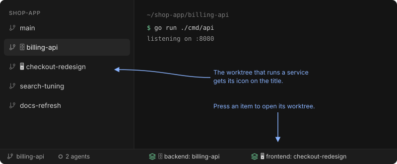

# Port Authority

An [Orca](https://github.com/stablyai/orca) plugin that shows which worktree runs the process on
each configured port.



*Illustration, not a screenshot. Title icons are optional.*

- A worker polls the ports with `lsof`. It reads the working directory of each listener and maps
  it to the Orca workspace (a worktree or a folder) that contains it.
- Each service has a status bar item, for example `🖥️ frontend: checkout-redesign`. Pressing it
  opens that worktree. A worktree that runs every service collapses to one `🛠️ stack` item.
- The items follow the processes. When a service stops, its item shows `down` on the next poll.

## Requirements

- Orca 1.4.257 or later.
- macOS or Linux, with `lsof` in `/usr/sbin`, `/usr/bin`, or `/bin`.

## Install

```sh
orca plugin install gagregrog/port-authority
```

Orca lists the access the plugin asks for and prints the command to approve it.

## Settings

Open Orca's Settings, then **Port Authority**.

- **Services**: one `label=port` per line, at most 6. The label is the status bar text. A leading
  emoji in the label is the title icon. Lines that start with `#` are skipped.
- **Stack label**: the label for a worktree that runs every service.
- **Mark worktree titles**: see below. Off by default.
- **Show status bar items**, **Status bar icon**, and the texts for a stopped service, for every
  service stopped, and for a port held outside every Orca workspace.
- **Poll interval**: 2 to 60 seconds.

## Title icons

Turn on **Mark worktree titles** to put the service icon before the owning worktree's title, for
example `🖥 checkout-redesign`, or `🛠` when it runs every service. The title comes back when the
service stops or moves.

This setting is off by default because it changes your worktree titles:

- Renaming a workspace makes Orca's display name fixed. A name that followed the branch stops
  following it, and the plugin cannot set it back to automatic.
- The plugin saves each marked workspace's original title in its own storage, and deletes it
  after it restores the title. Turn the setting off before you disable or uninstall the plugin.
  The plugin then restores the titles on the next poll.
- Orca refuses the emoji variation selector (U+FE0F) in a workspace name, so the title icon leaves
  it out. Some emoji, such as 🖥 and 🗄, can then draw as plain symbols. Emoji such as 💻 and 📦
  draw in color without it.

## What it runs

The plugin runs as a trusted worker: a Node.js process with your user account's access. It has
no dependencies and makes no network requests.

It runs one program, `lsof`, to find the listener on each port and its working directory. It
runs `lsof` from `/usr/sbin`, `/usr/bin`, or `/bin`, and does not search PATH.

It uses these Orca host calls:

- `workspace.list` (`workspace:read`), to read the workspaces on this machine.
- `workspace.open` (`workspace:write`), when you press a status bar item.
- `workspace.rename` (`workspace:write`), to add title icons while **Mark worktree titles** is on,
  and to restore the titles after you turn it off. With the setting off and no saved titles, the
  plugin renames nothing.

A listener that runs as another user never counts as a worktree's owner.

## Develop

```sh
orca plugin types .                   # writes the typings to .orca/types; run once after a clone
orca plugin test . --json
orca plugin validate . --json
npx -p typescript@7.0.2 tsc -p . --noEmit   # type check
orca plugin dev watch . --json        # loads this folder into Orca; Ctrl-C unloads it
```

`src/logic.ts` holds the pure functions and `src/logic.test.ts` tests them. `src/worker.ts` polls,
calls Orca, and updates the status bar.

## License

MIT. See [LICENSE](LICENSE).

The images in `docs/` are illustrations, not screenshots. Their layers, branch, and anchor shapes
come from [Lucide](https://lucide.dev), ISC License, Copyright (c) for portions of Lucide are held
by Cole Bemis 2013-2022 as part of Feather (MIT). All other copyright (c) for Lucide are held by
Lucide Contributors 2022.
